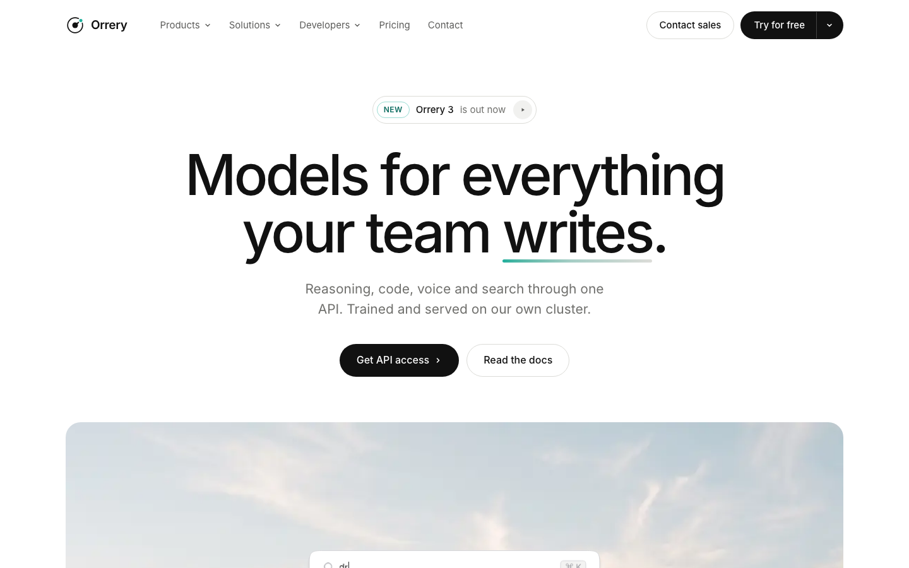

# Orrery

A free landing page template for a made-up AI model company called Orrery. It is illustrated with eleven animated assets in the Interface style by [Illos](https://illos.dev): small, flat pictures of product UI that loop while they are on screen.

[](https://vercel.com/new/clone?repository-url=https%3A%2F%2Fgithub.com%2Fnavedux%2Fillos-orrery-template)

Live demo: https://illos-orrery-template.vercel.app



The page opens on a wide photo with Orrery's command bar floating on it, then a grid of product cards (Code, Agent, Search, Realtime, Connectors), a row of numbers, a business section with a chat on a photo, an API section with code tabs and model cards, three "how it works" tiles, an infrastructure section on two photos, a security section, pricing with a monthly and yearly switch, a contact form and a footer.

Orrery is not a real company. Change the name, the copy and the numbers to your own.

## Run it

You need Node 20.11 or later. There is nothing to install.

```
npm run dev
```

This builds the page and serves it at http://127.0.0.1:4876. After you edit a file, run it again.

## Build it

```
npm run build
```

The finished site goes to `dist/`. It is plain HTML, CSS and JavaScript, so any static host can serve it. `npm run preview` serves `dist/` without building again. To use another port, run `node serve.mjs 3000`.

## Edit it

- `src/index.html` holds the page and all its copy.
- `src/styles.css` holds the styles. Colours, the radius and the shadows are CSS variables at the top.
- `src/main.js` runs the menus, the mobile menu, the rotating word in the headline, the agent log in the Code card, the counting numbers, the business chat, the code tabs and copy button, the pricing switch and the contact form.
- `public/illos/` holds the animated assets as SVG files, and `public/img/` the photos.
- `build.mjs` builds `dist/`, and `serve.mjs` serves it.

Each animated asset sits in the page as a tag such as `{{illos:orrery-command}}`. The build swaps the tag for the SVG inline, so the asset can read the page's colours. To move one, move its tag. To use another, drop the SVG into `public/illos/` and add a tag with its file name. Use each asset once per page.

The animated assets take their colours from the `--illos-*` variables at the top of `src/styles.css`. Change `--illos-accent` and the highlight in every asset follows.

## How the motion behaves

- Each animated asset loops while it is on screen and pauses when it scrolls away.
- With reduced motion turned on in the system settings, every asset shows one still frame, the headline word stops turning, and the agent log, the numbers and the business chat show their end state.

## Fonts

Inter and JetBrains Mono load from Google Fonts. To change them, edit the font link in `src/index.html` and the `--sans` and `--mono` variables.

## Licence

The code and the photos are MIT. The animated assets are free to use in sites you build from this template, but not to redistribute on their own. See `LICENSE.md`.

## More animated assets

The assets come from [Illos](https://illos.dev), where there are more in the same style, along with the skills that let your coding agent make new ones in your product's look.
